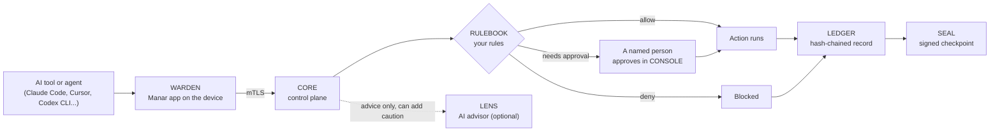

# Manar · منار

**Every AI action has an owner.**

Manar watches the AI tools and agents on your computers, asks a person before anything risky,
and keeps a tamper-evident record of everything they did.

[Website](https://manar.fixio.ae) ·
[Console](https://console-manar.fixio.ae) ·
[Try it with sample data](https://console-manar.fixio.ae/sample) ·
[Docs](https://manar.fixio.ae/en/docs) ·
[Pricing](https://manar.fixio.ae/en#pricing) ·
[العربية](https://manar.fixio.ae/ar)

---

## Why Manar

AI coding tools and agents now run commands, read files and call APIs on real machines with real
credentials. Most teams cannot answer three simple questions about them:

1. **What did the AI just do?**
2. **Who allowed it?**
3. **Can we prove it afterwards?**

Manar answers all three. Every action an agent takes goes through one path: the agent proves who
it is, your rules decide, a named person approves the risky ones, Manar carries the action out with
a key the agent never sees, and the result is written to a hash-chained record you can export.

## How it works

| Step | What happens |
| --- | --- |
| **Request** | The agent proves who it is with its own certificate. |
| **Decision** | Your policy decides: allow, needs approval, or deny. Fixed rules make the call, not a language model. The same rules and the same request give the same decision. |
| **Approval** | A named person signs off. An approval is used once and checked again before the action runs. |
| **Execution** | Manar acts with a key from its vault. The agent never sees the key. |
| **Record** | Every decision is hash-chained, so any change to the past can be detected. The record can be exported as a signed bundle. |

If the device cannot reach CORE, WARDEN blocks the action instead of letting it through.

## Components

Manar uses short product names. Repositories keep their code names.

| Product name | What it is | Where it runs | Repository |
| --- | --- | --- | --- |
| **CORE** | The control plane: agent identity, decisions, approvals, vault, audit | Manar servers | [`manar-api`](https://github.com/manarhq/manar-api) |
| **CONSOLE** | The web console where people approve requests and review what happened | Browser | [`manar-web`](https://github.com/manarhq/manar-web) |
| **WARDEN** | The Manar app on each device. Hooks into AI tools and asks CORE before every action | Windows 10/11, Linux | [`manar-edge`](https://github.com/manarhq/manar-edge) |
| **JAIL** | A sandbox that limits what an agent's process can reach on the network | On the device, inside WARDEN | [`manar-edge`](https://github.com/manarhq/manar-edge) |
| **DOOR** | A local AI gateway between the agent and model providers. Masks or blocks secrets in prompts and honours the kill switch | On the device, local only | [`manar-edge`](https://github.com/manarhq/manar-edge) |
| **GATE** | A gateway for MCP tools, used by cloud agents (ChatGPT, Claude, Copilot Studio) | Between agents and tools | |
| **RULEBOOK** | Your policy: the Watch, Ask and Strict presets plus your own rules | Inside CORE | |
| **LEDGER** | The tamper-evident, hash-chained audit record | Inside CORE | |
| **SEAL** | A signed checkpoint over the LEDGER chain | Inside CORE | |
| **LENS** | Optional AI advisor. It can only add caution; it never makes a decision | Manar servers | |
| **SCOUT** | The Discovered AI report: which AI tools are on which devices | Feeds CONSOLE | |
| **SITE** | The public website | Web | [`manar-landing`](https://github.com/manarhq/manar-landing) |

Some components live in private repositories for now.

## What Manar covers, tool by tool

We state exactly what Manar can do for each tool, and never claim more than the tool allows.

| Tool | Seen | Approve or deny | Secrets alert | Secrets blocked |
| --- | --- | --- | --- | --- |
| Claude Code | Yes | Yes (hook) | Yes | Yes |
| Cursor, Windsurf | Yes | Yes (hook) | Yes | Yes |
| Gemini CLI, Copilot CLI | Yes | Yes (hook) | Yes | Yes |
| Codex CLI | Yes | Gateway and MCP | Yes | Linux yes, Windows vault only |
| VS Code + Copilot | Yes | MCP tools only | Yes | Linux yes, Windows vault only |
| Claude desktop | Yes | MCP tools only | Yes | Linux yes, Windows vault only |
| ChatGPT desktop | Yes | Seen and alerted only | Yes | Linux yes, Windows vault only |
| Cloud agents (ChatGPT, Claude, Copilot Studio) | Yes | Yes (MCP gateway) | Not applicable | Not applicable |

*Vault only* means that on Windows, AWS and SSH keys moved into the Manar secret vault are blocked
for every tool, while other secret files raise an alert only. Each hook was checked against the
tool's own documentation; where a tool offers no way to gate its actions, we say so.

## Get started

1. **Sign in** at [console-manar.fixio.ae](https://console-manar.fixio.ae) with Microsoft, GitHub or email.
   Or look around first with [sample data](https://console-manar.fixio.ae/sample).
2. **Add a device.** The console gives you a one-line install command for Windows 10/11 or Linux.
3. **Pick a starting mode.**
   - **Watch**: see everything, block nothing yet.
   - **Ask**: risky actions wait for your approval.
   - **Strict**: risky actions are blocked unless a rule allows them.
4. **Use your AI tools as usual.** Approvals arrive in the console; everything lands in the record.

## Plans

Safety is never metered. Blocks, approvals, the secret vault and the audit record always work, on
every plan, even at zero credits.

| | Free | Pro | Company | Enterprise and Government |
| --- | --- | --- | --- | --- |
| Price | $0 | $5 a month, or $50 a year | $15 per active seat a month (minimum 3), or $150 per seat a year | Annual contract |
| Devices | 1 | 2 active included, $2 per extra active device | Unlimited | Contract |
| AI actions a month | 20 | 300 | 300 per seat, shared | Contract credit pool |
| History | 30 days | 1 year | 1 year | Contract |
| Extras | 14-day trial with up to 3 devices, no card | TLS inspection, priority email support | SSO, AD and Entra sync, roles and approvals | Hub and federation, air-gapped and government installs, TPM attestation, compliance packs |

Prices are in US dollars. UAE VAT of 5% is added at checkout for buyers in the UAE. Details and
examples: [manar.fixio.ae/en#pricing](https://manar.fixio.ae/en#pricing).

## Status

Manar is in **pilot**. It runs on our own servers in the UAE, people sign in and devices enroll
today, and we are starting free two-week pilots for teams of up to 50 developers.

Manar has not yet been benchmarked or run at large scale, and we do not publish availability or
performance figures we have not measured.

Next on the roadmap (targets, not promises):

- Company sign-in, user sync and security-tool feeds (SSO, SCIM, SIEM export)
- Plain-language rules: describe a rule and the AI advisor drafts it; you review it before it applies
- Open-source core (planned; see below)

Manar is a UAE Hackathon 2026 project, shortlisted for the post-hackathon phase of the
9th TDRA UAE Hackathon (Digital Trust and Cyber-Secure Nation).

## Open source

Manar is open-core. The public repositories above are licensed under
[Apache-2.0](https://github.com/manarhq/manar-api/blob/main/LICENSE). Premium features (Hub and
federation, directory sync, fleet management, compliance packs, air-gapped installs, TPM
attestation) are commercial and need a signed Manar licence.

- **Contributing:** see `CONTRIBUTING.md` in each repository. We use the DCO (`git commit -s`), not a CLA.
- **Trademark:** the code is open, the name is not. Forks must be renamed; see
  [`TRADEMARK.md`](https://github.com/manarhq/manar-api/blob/main/TRADEMARK.md).

## Security

Please do not open a public issue for a security problem. Report it privately through the
repository's **Security** tab ("Report a vulnerability") or by email to **security@fixio.ae**.
Each repository's `SECURITY.md` has the details and response targets.

## Contact

- Pilots and companies: [book a meeting](https://manar.fixio.ae/en/meet)
- Support: [support@fixio.ae](mailto:support@fixio.ae)
- Legal: [Terms](https://manar.fixio.ae/en/terms) · [Privacy](https://manar.fixio.ae/en/privacy) ·
  [Acceptable use](https://manar.fixio.ae/en/acceptable-use) · [Data processing](https://manar.fixio.ae/en/dpa)

---

Manar is a product of **Fixio Technologies LLC SPC**, Abu Dhabi, UAE.

